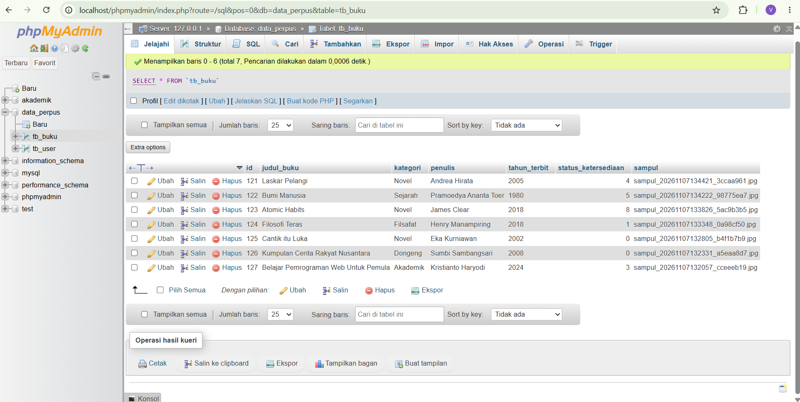
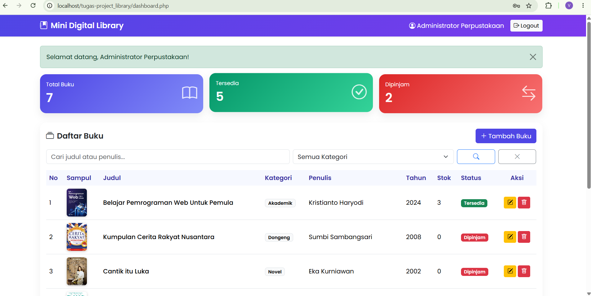
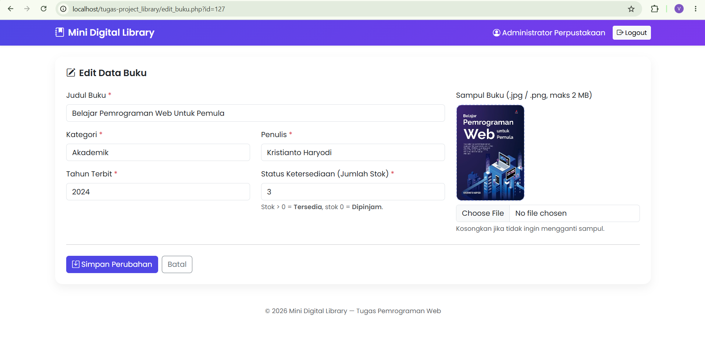

# 📚 Mini Digital Library

Aplikasi web **Sistem Informasi Perpustakaan Digital Mini** untuk mengelola data buku (CRUD) dengan autentikasi, session & cookie, serta upload sampul buku.
Dibuat dengan **PHP Native** (tanpa framework), **MySQL (mysqli)**, **Bootstrap 5**, dan **SweetAlert2**.

> Tugas Terstruktur — Mata Kuliah **Pemrograman Web** — Program Studi **Sistem Informasi**
> Nama: `<Vito Ade Chrisnanta>` | NIM: `<2513020056>` | Kelas: `<2C>`

- 🎥 **Video Demo (YouTube):** `https://youtu.be/hDTHFSfdsks`

---

## ✨ Fitur

| Modul | Fitur |
|---|---|
| **Autentikasi** | Login (POST), password di-hash (`password_hash`/`password_verify`), session, proteksi halaman, CSRF token |
| **Cookie** | "Remember Me" menyimpan username di cookie 30 hari (HttpOnly) |
| **Logout** | Menghapus session & cookie, redirect ke halaman login |
| **CRUD Buku** | Tambah, tampil (tabel + pencarian & filter kategori via GET), edit, hapus |
| **Upload Sampul** | Validasi ekstensi (.jpg/.png), MIME asli, ukuran maks **2 MB**, nama file acak; saat edit file lama diganti, saat hapus file fisik ikut di-`unlink` |
| **Logika Bisnis** | Stok > 0 → **Tersedia**, stok 0 → **Dipinjam** (if-else pada `label_status()`) |
| **Keamanan** | Prepared statement (anti SQL Injection), `htmlspecialchars` (anti XSS), hapus hanya via POST + CSRF |

## 🗂️ Struktur Project

```
tugas-project_library/
├── config/
│   ├── koneksi.php          
│   └── helper.php           
├── includes/
│   ├── header.php           
│   ├── footer.php           
│   └── form_buku.php        
├── assets/
│   ├── css/style.css
    ├── img
│   └── js/app.js           
├── uploads/                 
├── index.php                
├── proses_login.php         
├── logout.php               
├── dashboard.php            
├── tambah_buku.php          
├── proses_tambah.php       
├── edit_buku.php           
├── proses_edit.php          
├── hapus_buku.php           
└── db_perpustakaan.sql      
```

## ⚙️ Cara Menjalankan

1. Install **XAMPP / Laragon** (PHP 8+, MySQL/MariaDB). Jalankan Apache & MySQL.
2. Clone repositori ke folder web server:
   ```bash
   git clone <url-repositori> C:/xampp/htdocs/project_perpustakaan
   ```
3. Buka **phpMyAdmin** → **Import** → pilih `db_perpustakaan.sql`. Database yang dipakai: `data_perpus` (tabel `tb_buku` dan `tb_user`).
4. Sesuaikan kredensial di `config/koneksi.php` bila perlu (default: user `root`, password kosong).
5. Pastikan folder `uploads/` dapat ditulis (Linux/Mac: `chmod 755 uploads`).
6. Buka `http://localhost/tugas-project_library/`.

**Akun demo:** username `admin` — password `admin123`

## 🗄️ Struktur Tabel Database

### `tb_user`
| Kolom | Tipe | Keterangan |
|---|---|---|
| id | INT UNSIGNED, PK, AUTO_INCREMENT | |
| username | VARCHAR(50), UNIQUE | |
| password | VARCHAR(255) | hash bcrypt |
| nama_lengkap | VARCHAR(100) | |

### `tb_buku`
| Kolom | Tipe | Keterangan |
|---|---|---|
| id | INT, PK, AUTO_INCREMENT | |
| judul_buku | VARCHAR(150) | |
| kategori | VARCHAR(50) | |
| penulis | VARCHAR(100) | |
| tahun_terbit | INT | |
| status_ketersediaan | INT | jumlah stok: > 0 = Tersedia, 0 = Dipinjam |
| sampul | VARCHAR(255) NULL | nama file di `uploads/` |

## 📸 Screenshot

| Halaman | Screenshot |
|---|---|
| Database MySQL |  |
| Login |  |
| Dashboard (Read) |  |
| Tambah Buku (Create) |  |
| Edit Buku (Update) |  |
| Konfirmasi Hapus (Delete) |  |
| Pencarian & Filter | 
